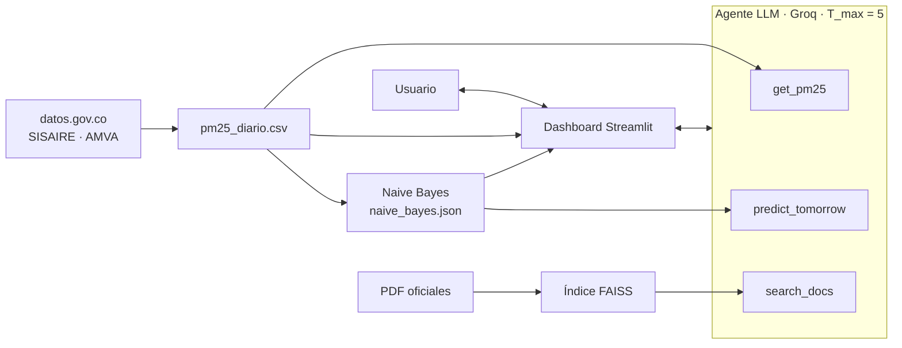

# Aire Aburrá: agente de calidad del aire del Valle de Aburrá

Proyecto final de **SI3003 – Inteligencia Artificial** (Universidad EAFIT, 2026).
Reto 3.1 del enunciado: *Agente de calidad del aire del Valle de Aburrá*.

**Problema.** El PM2.5 del día se publica como un número, pero la mayoría de las personas no sabe qué significa ni qué hacer con él.
Esta aplicación muestra el PM2.5 medido en las estaciones del valle, predice la categoría de calidad del aire del día siguiente y
responde preguntas en lenguaje natural citando la normativa.

| Componente | Qué hace | Dónde está |
|---|---|---|
| **Parte 1 · técnica clásica** | Naive Bayes categórico implementado desde cero (numpy) que predice la clase ICA del día siguiente. Se compara con dos líneas base: clase mayoritaria y persistencia. | `src/model.py`, `src/features.py`, `src/train.py` |
| **Parte 2 · agente LLM** | Loop agéntico manual con tool calling, T_max y errores devueltos como observación. Cuatro herramientas: `get_pm25`, `predict_tomorrow`, `search_docs` (RAG) y `list_stations`. | `src/agent.py`, `src/tools.py` |
| **RAG** | Documentos oficiales fragmentados por página, embeddings multilingües e índice FAISS. Cada respuesta cita documento y página. | `src/rag.py`, `docs/` |
| **Dashboard** | Streamlit: mapa de estaciones, serie de tiempo, predicción y chat con el agente. | `app.py` |
| **Evaluación** | 14 preguntas fijas para el agente; partición temporal, validación y ablación para el modelo. | `eval/`, `notebooks/` |

La combinación de las dos partes no es decorativa: el modelo de la Parte 1 **es una herramienta del agente**. Cuando el usuario pregunta
«¿cómo estará mañana y qué debo hacer?», el agente llama a `predict_tomorrow` (Naive Bayes) y con la categoría predicha consulta
`search_docs` (RAG) para responder con las medidas que indican los documentos.



## Ejecución rápida

Requisitos: Python 3.10 o superior y una clave gratuita de [Groq](https://console.groq.com/keys).

```bash
git clone https://github.com/jjgarciau/agente-IA-calidad-del-aire.git
cd agente-IA-calidad-del-aire

python -m venv .venv
.venv\Scripts\activate            # Windows (PowerShell).  Linux/macOS: source .venv/bin/activate
pip install -r requirements.txt

copy .env.example .env            # Linux/macOS: cp .env.example .env
# Edita .env y pega tu clave en GROQ_API_KEY

python -m src.config --ping       # comprueba la conexión con el LLM
streamlit run app.py
```

El repositorio incluye los datos diarios procesados, el modelo entrenado y el índice del RAG, así que la aplicación arranca sin
pasos adicionales. La primera vez que el asistente consulta los documentos se descarga el modelo de embeddings (unos 470 MB).
Sin `GROQ_API_KEY` el dashboard funciona completo salvo el chat, que muestra un aviso.

> Si PowerShell bloquea la activación del entorno, ejecuta antes `Set-ExecutionPolicy -Scope Process RemoteSigned`.

## Reproducir todo desde cero

Cada paso lee lo que dejó el anterior. Ninguno requiere intervención manual, salvo descargar los PDF del corpus.

| Paso | Comando | Qué produce |
|---|---|---|
| 1. Descargar datos horarios | `python -m src.download_data` | `data/raw/pm25_AAAA-MM.csv` (no se suben al repositorio) |
| 2. Promedio diario + ICA | `python -m src.preprocess` | `data/processed/pm25_diario.csv`, `data/stations.csv` |
| 3. Entrenar y evaluar el modelo | `python -m src.train` | `models/naive_bayes.json`, `models/metricas.json` |
| 4. Corpus del RAG | Descargar los PDF listados en `docs/fuentes.csv` a `docs/` | — |
| 5. Construir el índice | `python -m src.build_index` | `index/faiss.index`, `index/chunks.json` |
| 6. Evaluar el agente | `python -m eval.run_eval` | `eval/resultados.csv`, `eval/resultados.md`, `eval/trazas.json` |
| 7. Resumen de resultados | `python -m src.reporte` | `RESULTADOS.md` |
| 8. Pruebas automáticas | `python -m pytest -q` | 38 pruebas (no necesitan internet ni clave) |
| 9. Notebooks | `jupyter nbconvert --to notebook --execute --inplace notebooks/*.ipynb` | EDA y análisis del modelo con sus figuras |

La descarga es reanudable: si se interrumpe, al repetir el comando solo se piden los meses que faltan.
Plan B si la API está lenta: `python -m src.download_data --desde 2024-01-01`.

Para preguntar al agente sin abrir el dashboard:

```bash
python -m src.agent "¿Cómo estará mañana y qué se recomienda?" --estacion "TRÁFICO CENTRO" --fecha 2025-03-12
```

## Datos

- **Fuente:** conjunto [Calidad del Aire en Colombia](https://www.datos.gov.co/Ambiente-y-Desarrollo-Sostenible/Calidad-del-Aire-en-Colombia/g4t8-zkc3)
  (SISAIRE, IDEAM), id `g4t8-zkc3` en datos.gov.co, consultado por su API Socrata.
- **Filtro:** autoridad ambiental `AMVA` (Área Metropolitana del Valle de Aburrá), variable `PM2.5`, mediciones horarias en µg/m³, de 2022-01-01 a 2025-12-31.
- **Limpieza** (`src/preprocess.py`): se descartan valores negativos o mayores a 500 µg/m³ y mediciones duplicadas; un día es válido con al menos
  18 de 24 horas; se conservan las estaciones con al menos 180 días válidos.
- **Categorías:** puntos de corte del ICA para PM2.5 de 24 horas de la Resolución 2254 de 2017 (0–12, 13–37, 38–55, 56–150, 151–250, 251–500 µg/m³).
- **Uso responsable:** son datos abiertos y agregados por estación; no hay datos personales. Los datos son históricos, no en tiempo real:
  la «fecha de referencia» del dashboard hace las veces de «hoy».

## Parte 1: Naive Bayes categórico

Se predice la clase ICA del día *t+1* en cada estación (Buena, Aceptable, Dañina para grupos sensibles, Dañina o peor) con seis variables
categóricas conocidas el día *t*: nivel de PM2.5 de hoy, clase de ayer, tendencia, temporada, tipo de día objetivo y nivel promedio del valle.

- **Implementación propia:** conteos, suavizado de Laplace y log-probabilidades en numpy (`src/model.py`, menos de 100 líneas).
  Las pruebas verifican que da las mismas probabilidades que `CategoricalNB` de scikit-learn, que solo se usa para esa comprobación.
- **Protocolo:** partición temporal (entrenamiento hasta 2024, prueba en 2025), α elegido en una validación interna, una sola evaluación en prueba y ablación por variable.
- **Métricas:** exactitud, F1-macro, y precisión y recall de «episodio» (Dañina para grupos sensibles o peor), frente a clase mayoritaria y persistencia.

## Parte 2: agente con RAG y herramientas

- **Loop** (`src/agent.py`): el del curso (Clase 12), con `T_max = 5` iteraciones. Si se agota, se pide una respuesta final sin herramientas y se avisa.
- **Errores:** las herramientas nunca lanzan excepciones; devuelven `{"error": ...}` con una pista (estaciones parecidas, fechas válidas cercanas)
  y el LLM lo recibe como observación para corregir o explicar.
- **Citas:** `search_docs` devuelve cada fragmento con su cita `[Fuente: título, p. N]`; el prompt obliga a citar y a reconocer cuando los documentos no contienen la respuesta.
- **RAG** (`src/rag.py`): fragmentos de ~500 caracteres (límite del modelo de embeddings), `paraphrase-multilingual-MiniLM-L12-v2`, FAISS `IndexFlatIP` sobre vectores
  normalizados y umbral de similitud de 0.30.
- **Proveedor:** Groq, con el modelo `openai/gpt-oss-120b` (configurable en `.env`; sirve cualquier endpoint compatible con OpenAI).

## Resultados

Los resultados de la última corrida están en **[RESULTADOS.md](RESULTADOS.md)**, generado por `python -m src.reporte`:
métricas del modelo frente a las líneas base, matriz de confusión, ablación y evaluación del agente pregunta por pregunta.
El dashboard muestra lo mismo en la pestaña «Modelo y evaluación».

## Limitaciones

- El modelo no usa meteorología (lluvia, viento, capa de mezcla), que es lo que físicamente dispara o disipa un episodio; solo ve la inercia del PM2.5 y el calendario.
- Naive Bayes supone independencia entre variables que aquí están correlacionadas, por lo que sus probabilidades tienden a ser extremas.
- Los episodios son poco frecuentes: la exactitud global dice poco y por eso se reporta el recall de episodio.
- Los datos terminan el 2025-12-31; no hay consulta en tiempo real.
- Varias tablas de la Resolución 2254 están incrustadas como imágenes en el PDF y no llegan al índice; esos valores se recuperan de otros documentos del corpus.
- El umbral del RAG se fijó a mano; con otro corpus hay que recalibrarlo (`python -m src.build_index` muestra similitudes de referencia).
- La evaluación del agente tiene 14 preguntas y un solo modelo de lenguaje; no mide variabilidad entre corridas.

**Esta es una herramienta analítica con fines académicos. No constituye consejo médico, legal ni de seguridad, y no reemplaza el pronóstico oficial del SIATA.**

## Estructura

```text
app.py                     dashboard Streamlit
src/
  config.py                rutas, parámetros y cliente del LLM
  download_data.py         descarga desde datos.gov.co (Socrata)
  preprocess.py            limpieza, promedio diario y categoría ICA
  ica.py                   puntos de corte del ICA
  features.py              variables del modelo
  model.py                 Naive Bayes, líneas base y métricas (implementación propia)
  train.py                 entrenamiento, validación, prueba y ablación
  rag.py, build_index.py   corpus, embeddings e índice FAISS
  tools.py                 herramientas del agente
  agent.py                 loop agéntico
  reporte.py               genera RESULTADOS.md
eval/                      preguntas de prueba y script de evaluación
notebooks/                 01_eda.ipynb, 02_modelo.ipynb
docs/                      documentos del RAG y fuentes.csv
data/, models/, index/     datos procesados, modelo e índice
tests/                     pruebas automáticas (datos sintéticos, sin internet)
informe/                   informe y declaración de uso de IA
```

## Documentos del proyecto

- Informe: [`informe/informe.md`](informe/informe.md)
- Declaración de uso de IA generativa: [`informe/declaracion_ia.md`](informe/declaracion_ia.md)
- Procedencia del corpus: [`docs/fuentes.csv`](docs/fuentes.csv)

Versiones con las que se probó: Python 3.13, numpy 2.5, pandas 3.1, scikit-learn 1.9, openai 3.49, faiss-cpu 1.16, pypdf 7.0, streamlit 1.67, plotly 7.1.
